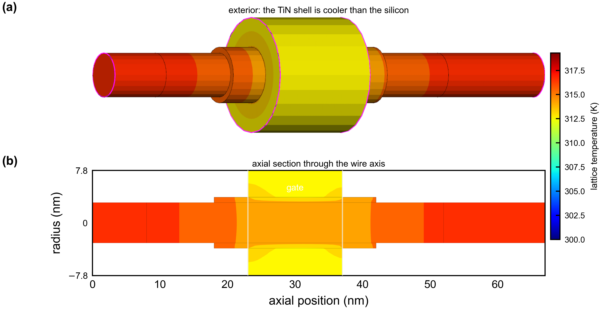
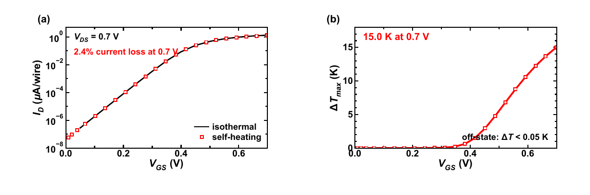
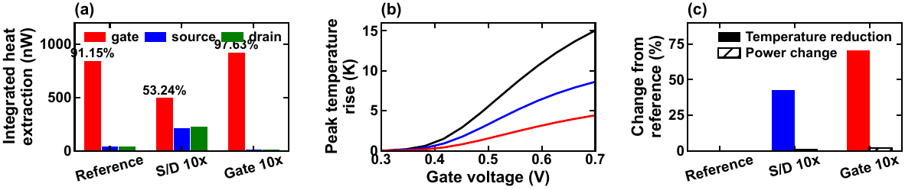
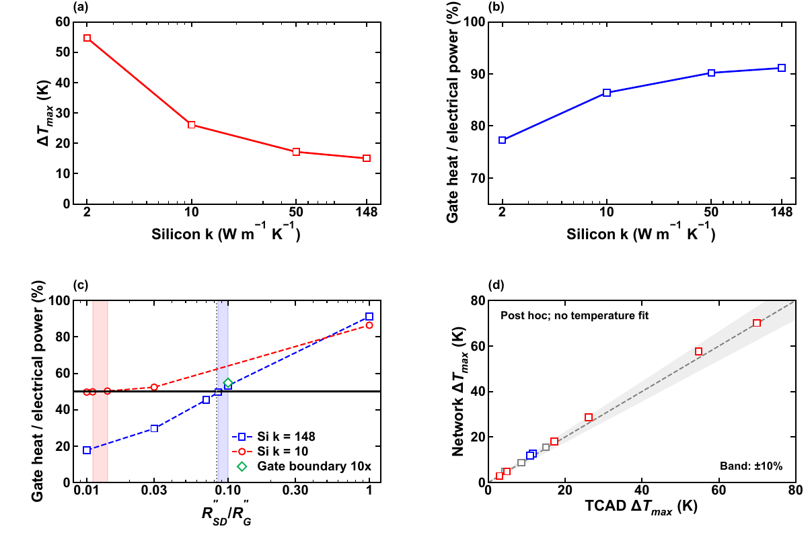
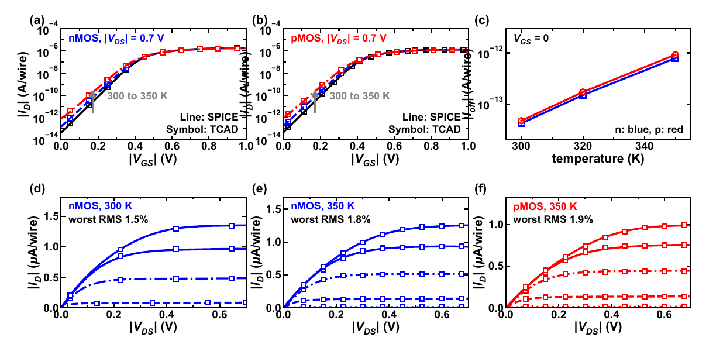

# Heat Extraction in a 14 nm Junctionless Gate-All-Around Silicon Nanowire Transistor

**3D electrothermal TCAD shows that the gate removes 91% of the dissipated power in the reference device. Lowering the source/drain thermal boundary resistance can reverse that, and the resistance ratio at which the reversal happens depends on the effective thermal conductivity of the silicon.**

> **Publication status: manuscript in preparation.** A manuscript reporting this work by **Tushar Dudeja and Nawaz Shafi** (Vellore Institute of Technology), *"Heat Extraction and Thermal Boundary Effects in a 14-nm-Gate-Length Junctionless Gate-All-Around Silicon Nanowire Transistor"*, is being prepared for **IEEE Access**. This repository summarizes the study, with figures posted by the authors. Simulation decks, meshes, SPICE cards and raw data are **not released** (see [What is not released](#what-is-not-released-and-why)).

<em>Figure 1. Temperature field at VGS = 1.0 V and VDS = 0.7 V: (a) external view and (b) axial section, on a 300-319.3 K scale.</em>

---

## 1. Motivation

In a gate-all-around nanowire, the channel is wrapped in gate dielectric and connected to the outside world through only three paths: the gate stack, the source contact and the drain contact. Self-heating raises the channel temperature, which degrades drive current and accelerates aging. Which path removes the heat depends on two things that are easy to change in a process and hard to measure: the internal thermal transport of a few-nanometer silicon wire, and the thermal resistance of the external connections.

Junctionless devices make this sharper. With uniform doping and no junctions, current and heat generation spread differently than in an inversion-mode transistor.

**Question:** in a junctionless GAA nanowire at a 14 nm gate length, where does the heat go, and what would it take to change that?

## 2. Device

| Parameter | Value |
|---|---|
| Architecture | Junctionless, cylindrical gate-all-around silicon nanowire |
| Gate length | 14 nm |
| Nanowire radius | 3 nm (diameter 6 nm) |
| Gate oxide | 0.8 nm SiO2 |
| Doping | Uniform, 5 × 1018 cm−3 |
| Gate work function | 4.60 eV |
| Reference bias | VGS = VDS = 0.7 V |
| Thermal conductivities (reference) | Si 148, SiO2 1.4, Si3N4 30 W/(m·K) |
| Reference boundary resistance | 10−4 K·cm2/W at gate and source/drain |

The 148 W/(m·K) silicon value is a bulk-like reference, not a measurement of a 6 nm wire. Boundary scattering lowers the real value, so lower conductivities are swept explicitly (Section 4.2).

## 3. Method

- **Electrothermal TCAD:** 3D Synopsys Sentaurus simulations, solving carrier transport coupled to the lattice heat equation.
- **Heat accounting:** gate heat is read from the gate thermal electrode, and source/drain heat from the integrated boundary-sink flows. In the reference device, the external heat budget closes to **0.06% of the electrical power**.
- **Design sweeps:** effective silicon thermal conductivity, and the gate and source/drain thermal boundary resistances, varied one at a time and in combination.
- **Mesh checks:** the reference device and an extreme low-conductivity case were re-solved on three meshes (21,609 to 39,703 vertices).
- **Reduced-order model:** a three-rail coaxial thermal network was set up and then tested against TCAD cases it had not been fitted to.
- **Compact models:** temperature-aware n- and p-type SPICE models were fitted to the TCAD output characteristics and used in static inverter and NAND circuit simulations.

## 4. Results

### 4.1 Reference device

| At VGS = VDS = 0.7 V | Value |
|---|---|
| Peak temperature rise | **15.03 K** |
| Drive-current loss from self-heating | 2.40% |
| **Power extracted through the gate** | **91.15%** |

The gate is the dominant heat path, so the channel temperature follows the gate boundary condition.

<em>Figure 2. Self-heating at VDS = 0.7 V: (a) isothermal and self-heated transfer curves, with a 2.4% current reduction at 0.7 V; (b) peak rise versus gate bias, reaching 15.03 K at 0.7 V.</em>

### 4.2 Changing the boundaries

Reducing each boundary resistance tenfold, at fixed bias:

| Change | Peak temperature rise |
|---|---|
| Source/drain boundary resistance ÷10 | 42.6% lower |
| Gate boundary resistance ÷10 | 70.5% lower |

<em>Figure 3. Thermal-boundary comparisons at VDS = 0.7 V. "S/D 10x" and "Gate 10x" reduce the respective boundary resistance tenfold. (a) Integrated heat extraction at VGS = 0.7 V (percentages: gate heat / electrical power); (b) peak rise vs gate bias; (c) temperature reduction (solid) and power change (hatched) relative to the reference.</em>

**Crossover.** Lowering the source/drain boundary resistance far enough makes the ends, not the gate, the main heat path. The point where the gate removes exactly half the heat falls between these source/drain-to-gate resistance ratios:

| Effective Si thermal conductivity | Crossover ratio |
|---|---|
| 148 W/(m·K) | 0.085-0.100 |
| 10 W/(m·K) | 0.011-0.014 |

Because the crossover moves by almost an order of magnitude with the internal conductivity, **contact area alone cannot determine which path dominates**. Lower silicon conductivity restricts axial heat spreading toward the gated region and shifts the resistance ratio at which end extraction competes with the gate.

<em>Figure 4. (a) Peak rise and (b) gate heat / electrical power vs silicon thermal conductivity at reference boundaries. (c) Gate share vs source/drain-to-gate boundary-resistance ratio; shading marks the crossover intervals (0.085-0.100 at 148 and 0.011-0.014 at 10 W/(m·K)). (d) Thermal-network vs TCAD peak rise, compared after the TCAD calculations; the ±10% band is a visual guide, not an accuracy guarantee.</em>

### 4.3 Numerical checks

- **Mesh:** across three meshes, the peak temperature rise varies by 0.37% and the gate heat fraction stays at 91.12-91.15%.
- **Thermal network:** on coupled cases it was not fitted to, the network predicts the temperature rise within 4.3% and 13.0%. It captures the trends, but it is not a substitute for TCAD.
- **Compact models:** all 35 available output curves are reproduced below 3% RMS (worst 2.01%). An independent check at 335 K, not used in fitting, gives a worst-case RMS of 1.87%.

<em>Figure 5. Compact-model calibration against TCAD. (a, b) nMOS/pMOS transfer curves at 0.7 V drain bias, at 300/320/350 K (black/blue/red); (c) zero-gate leakage; (d-f) output curves. Open squares are TCAD and lines are PrimeSim.</em>

## 5. Limitations

- Nanowire thermal conductivity is a swept parameter, not measured. Phonon boundary scattering and confinement are not resolved separately, so the effective conductivity stands in for them.
- The results are continuum electrothermal TCAD for one geometry and bias. The crossover intervals describe this device, not a process-independent optimum.
- Heat fraction alone does not give the temperature reduction per unit of design cost.
- The compact models are fitted to TCAD, so the circuit results are predictions of the calibrated model, not independent circuit TCAD.

## What is not released, and why

The Sentaurus decks, meshes, SPICE model cards, circuit netlists and raw data are not published while the manuscript is in preparation. The input files also depend on licensed Synopsys TCAD tools and material libraries. Figures and results are posted by the authors; further detail is available on request.

## Authors

**Tushar Dudeja** and **Nawaz Shafi**, Vellore Institute of Technology, Vellore, India
[LinkedIn](https://linkedin.com/in/tushardudeja) · [GitHub](https://github.com/thetushardudeja1)

© 2026 Tushar Dudeja and Nawaz Shafi. All rights reserved. Reuse requires the authors' permission.
